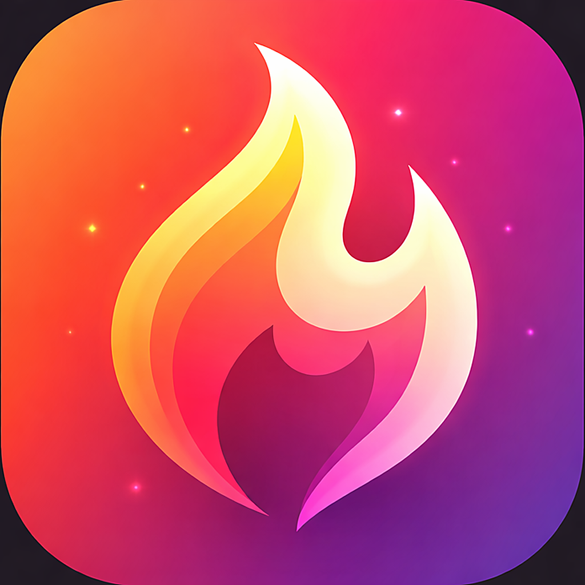

# Fyre

<p align="center">
  
</p>

Fyre is a high-school final project built by a small team. It is a multi-platform dating, social discovery, messaging, and events app with web, Android, and iOS clients backed by Appwrite.

## Features

- authentication and profile setup;
- discovery, swipes, matches, and relationship controls;
- private chat with attachments;
- events, waitlists, and administration tools;
- local notifications and realtime updates where supported.

## Repository

| Path | Contents |
| --- | --- |
| [`web/`](web/README.md) | React, TypeScript, and Vite client |
| [`android/Fyre/`](android/Fyre/README.md) | Kotlin and Jetpack Compose client |
| [`ios/Fyre/`](ios/Fyre/README.md) | Swift and SwiftUI client |
| [`functions/`](functions/README.md) | Appwrite functions |
| [`appwrite/`](appwrite/README.md) | Reproducible Appwrite schema and deployment guide |
| [`shared/contracts/`](shared/contracts/index.d.ts) | Shared JavaScript and TypeScript contracts |
| [`.github/workflows/`](.github/workflows/ci.yml) | CI for web, backend, Android, and iOS |

## Quick start

An offline demo for all three clients is available on the [`demo` branch](https://github.com/itsminni/fyre/tree/demo).

To try the app without a backend, use the offline demos: [Web](web/README.md#offline-demo), [Android](android/Fyre/README.md#offline-demo), or [iOS](ios/Fyre/README.md#offline-demo). The connected clients require your own Appwrite backend. First [configure your own Appwrite project](appwrite/README.md#one-time-appwrite-setup), deploy the schema and functions, and fill the ignored client configuration files with its endpoint and resource IDs.

### Web

```sh
cd web
cp .env.example .env.local
npm ci
npm run dev
```

### Android

```sh
cd android/Fyre
cp local.properties.example local.properties
./gradlew assembleDebug
```

Fill in the public Appwrite values, then set `APPWRITE_BACKEND_ENABLED=true`.

### iOS

```sh
cd ios/Fyre
cp Fyre/Config.example.plist Fyre/Config.plist
open Fyre.xcodeproj
```

Select the shared `Fyre` scheme and a simulator or device.

## Python tooling

Python 3.11+ is required for the maintenance scripts. Install the pinned Ruff version with `python -m pip install -r requirements-lint.txt`, then run:

```sh
ruff check scripts
ruff format --check scripts
python -m unittest discover -s scripts -p '*_test.py'
```

---

## Italiano

Fyre è un progetto finale di quinta superiore realizzato da un piccolo gruppo. È un'app multipiattaforma per dating, social discovery, messaggistica ed eventi, con client web, Android e iOS e backend Appwrite.

### Funzionalità

- autenticazione e configurazione del profilo;
- discovery, swipe, match e gestione delle relazioni;
- chat privata con allegati;
- eventi, lista d'attesa e strumenti amministrativi;
- notifiche locali e aggiornamenti realtime dove supportati.

### Repository

| Percorso | Contenuto |
| --- | --- |
| [`web/`](web/README.md#italiano) | Client React, TypeScript e Vite |
| [`android/Fyre/`](android/Fyre/README.md#italiano) | Client Kotlin e Jetpack Compose |
| [`ios/Fyre/`](ios/Fyre/README.md#italiano) | Client Swift e SwiftUI |
| [`functions/`](functions/README.md#italiano) | Funzioni Appwrite |
| [`appwrite/`](appwrite/README.md#italiano) | Schema Appwrite riproducibile e guida al deploy |
| [`shared/contracts/`](shared/contracts/index.d.ts) | Contratti JavaScript e TypeScript condivisi |
| [`.github/workflows/`](.github/workflows/ci.yml) | CI per web, backend, Android e iOS |

### Avvio rapido

Una demo offline dei tre client è disponibile nel [branch `demo`](https://github.com/itsminni/fyre/tree/demo).

Per provare Fyre senza backend sono disponibili le demo offline [web](web/README.md#demo-offline), [Android](android/Fyre/README.md#demo-offline) e [iOS](ios/Fyre/README.md#demo-offline). I client connessi richiedono un backend Appwrite proprio. Prima [configurare un proprio progetto Appwrite](appwrite/README.md#configurazione-iniziale-su-appwrite), distribuire schema e funzioni e compilare i file client ignorati con endpoint e ID delle risorse.


#### Web

```sh
cd web
cp .env.example .env.local
npm ci
npm run dev
```

#### Android

```sh
cd android/Fyre
cp local.properties.example local.properties
./gradlew assembleDebug
```

Compilare i valori pubblici Appwrite e impostare `APPWRITE_BACKEND_ENABLED=true`.

#### iOS

```sh
cd ios/Fyre
cp Fyre/Config.example.plist Fyre/Config.plist
open Fyre.xcodeproj
```

Selezionare lo schema condiviso `Fyre` e un simulatore o dispositivo.

### Strumenti Python

Gli script di manutenzione richiedono Python 3.11+. Installare la versione fissata di Ruff con `python -m pip install -r requirements-lint.txt` ed eseguire:

```sh
ruff check scripts
ruff format --check scripts
python -m unittest discover -s scripts -p '*_test.py'
```
